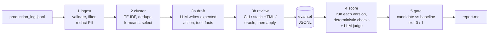

# evalgen: from production logs to a regression gate

Teams shipping LLM features rarely lack logs; they lack a test set that reflects what users actually ask and where the model actually fails. Hand-written eval sets drift away from traffic, and rerunning a vibe check before every model or prompt change does not scale. `evalgen` turns a production log into a small, reviewed evaluation set and uses it as a release gate: it pulls prompts and responses from the log, clusters them to surface representative, rare and failing cases, drafts expected outputs with an LLM, puts every draft through a human review step, scores each new model version with deterministic checks plus an LLM judge, and exits non-zero when a candidate is worse than the baseline. Everything runs offline against a local Ollama server.

The production log here is synthetic (a support assistant for **Ledgerfox, a fictional invoicing app**), generated with a fixed seed and seeded with known failure modes so that every step can be checked against ground truth.

## Architecture



Each step reads the previous step's artifact from a run directory and writes its own (`01_logs.jsonl`, `02_selected.jsonl`, `03_eval_set.jsonl`, `04_scores_<version>.jsonl`, `05_gate_<version>.json`), so any step can be rerun or inspected on its own. Every LLM call goes through a sqlite3 cache keyed on the full request, which makes reruns exact and cheap.

## How each step works, and why

**1. Ingest** (`evalgen/ingest.py`). Every log line is parsed and validated against dataclass schemas (`evalgen/schema.py`); bad lines are rejected with a reason instead of crashing the run (the synthetic log contains three on purpose: truncated JSON, a missing field, an unknown action). E-mail addresses and phone numbers are redacted before anything is stored or sent to a model. Optional filters: time window, model version, limit.

**2. Cluster and select** (`evalgen/cluster.py`, `evalgen/signals.py`).
- TF-IDF (unigrams and bigrams, sublinear tf, L2 norm) implemented in numpy, with IDs and numbers abstracted (`INV-20931` becomes `invoiceid`) so that "is INV-1 paid" and "is INV-2 paid" collapse.
- Near-duplicates are grouped greedily at cosine >= 0.85; a group keeps its size as a frequency weight.
- Spherical k-means (k-means++ init, fixed seed, 8 restarts, weighted by group size); k is chosen by silhouette over a range.
- Failure signals that need no ground truth: thumbs-down feedback, refusal phrasing, numbers in the reply that are not in the retrieved documentation, an invoice/account ID or dispute mentioned without the matching tool call, and an answer to a prompt that shares no content word with the documentation (possible off-topic compliance).
- Selection under a budget: one representative per cluster (largest clusters first), then the groups with the strongest failure signals (capped per cluster and at 30% of the budget), then prompts that are lexically isolated inside their cluster (rare intents that k-means merged into a bigger cluster tend to land here), then coverage of the largest clusters.

**3a. Draft** (`evalgen/draft.py`). An LLM writes the expected output for each selected case: the action (`answer`, `tool_call` or `decline`), the tool and its key argument, 1 to 3 short required facts, and a reference answer. Output is constrained by a JSON schema, parsed, validated, and retried once on failure. The drafter does **not** see the production reply, so it cannot copy a hallucinated number into the reference. A deterministic check flags any required fact whose numbers do not exist in the documentation.

**3b. Review** (`evalgen/review.py`). Nothing reaches the eval set without a decision:
- `review cli`: terminal loop (accept / edit / reject / skip), resumable, saves after every item.
- `review html`: writes a self-contained static page (`03_review.html`, no external assets) with the user message, documentation, production reply, failure signals and an editable draft; decisions persist in the browser and are exported as `decisions.json`.
- `review oracle`: a scripted reviewer that has the synthetic ground truth. It exists so the reference run is reproducible without a human, and so the drafts can be measured: it accepts a draft only when the action, tool and argument are right and the required facts match the gold facts (no missing fact, no unrequested one); it edits anything fixable and rejects ambiguous requests.
- `review apply` validates a decisions file against the drafts and writes the eval set.

**4. Score** (`evalgen/score.py`). Each version (a model plus a prompt variant) answers every eval item with the same pinned decoding (temperature 0, seed 42) and a JSON output schema. Two independent graders:
- Deterministic checks: action match (and right tool and key argument for tool calls); required-fact recall, where a numeric fact is present when all its numbers are present and a non-numeric fact needs 60% of its content words; unsupported numbers (in the reply but not in the documentation, the user message or the reference). `det_score` is 0 for a wrong action, otherwise the fact recall, halved if the reply contains an unsupported number.
- LLM-as-judge with a fixed 1 to 5 rubric (`JUDGE_RUBRIC`), given the documentation, the reviewed expectation and the reply; normalised to 0 to 1.
- `combined` is the mean of the two. The report shows both components, per expected action and per cluster, and how often the graders agree on pass/fail.

All versions predict first and the judge runs last, and each model is unloaded after its phase, so only one model is in memory at a time (the machine has 16 GB of RAM).

**5. Gate** (`evalgen/gate.py`). Compares a candidate's per-item scores with the baseline's on the same items and exits 1 when any rule fires: overall mean drop above 0.05; a drop above 0.15 in any cluster with at least 3 items; more than 3 items that pass on the baseline and fail on the candidate. A paired bootstrap 95% interval of the overall delta is reported next to the verdict. It is informational on purpose: the thresholds decide, because a CI gate must be predictable. Exit codes: 0 pass, 1 regression, 2 error.

### Deliberate constraints

- **Zero install, runs offline.** Python standard library plus numpy and requests. No scikit-learn, pydantic, DuckDB or Streamlit: validation is dataclasses, storage is JSON/JSONL plus sqlite3 for the cache, clustering is numpy, configuration is TOML (`tomllib`), and the review UI is one static HTML file.
- **Pluggable provider.** `evalgen/providers.py` defines a two-method interface (`chat`, `release`). `OllamaProvider` (POST `/api/chat`, `stream: false`, temperature 0, fixed seed) is used for every real run. `OpenAICompatibleProvider` targets any `/v1/chat/completions` endpoint, reads `EVALGEN_OPENAI_BASE_URL` and `EVALGEN_OPENAI_API_KEY`, and is covered by mocked tests only: it was never called against a paid API.
- **Synthetic, reproducible data.** `python -m evalgen synth --seed 42` regenerates byte-identical files. 24 intents over 12 documentation pages, phrased with templates plus greeting/suffix noise, lowercasing, typos and the occasional e-mail address. Injected failures: hallucinated numbers, refusals of answerable questions, answering off-topic requests, wrong or missing tool calls. Ground truth goes to a separate file that the pipeline never reads; only the oracle reviewer and the clustering diagnostics use it.

## Results

All numbers below come from one uncached run of `python3 -m evalgen --run-dir results run-all` (47 min wall time on an Apple M5 laptop with 16 GB of RAM), whose artifacts are committed under `results/` (`results/report.md` has the full tables, including per-cluster scores). Drafter and judge: `qwen3.5:9b`. Baseline: `qwen2.5:7b` with the production prompt.

**Dataset and selection** (step 1 and 2, checked against the hidden ground truth)

| | value |
|---|---|
| log lines read / valid records / rejected | 303 / 300 / 3 |
| PII spans redacted | 7 |
| unique prompts after near-duplicate collapse | 133 |
| clusters (k chosen by silhouette in 12..32) | 27 |
| cluster purity against the 24 true intents | 0.72 |
| items selected (budget 48) | 48 |
| intents covered by the selection | 21 / 24 (rare intents, at most 6 records each: 6 / 8) |
| share of items that failed in production: whole log vs selection | 16.3% vs 58.3% |

**Drafts and review** (step 3). All 48 drafts parsed and validated. The oracle reviewer accepted 31, edited 15 and rejected 2 (the two ambiguous prompts, "the thing is broken again" and "help", which the drafter turned into a decline and an answer instead of flagging them). Action, tool and key argument were right on all 46 unambiguous items. 14 of the 15 edits narrowed the required facts to what the question asked (for example removing "up to 5 users" from "how much is Growth?") or shortened a sentence-length fact; 1 replaced wrong facts (the drafter listed plan prices for a question about the annual discount). Result: 46 eval items. The author then went through all 48 drafts and the oracle's decisions in the HTML review page and did not disagree with any of them.

**Scores** (step 4)

| version | change vs baseline | action acc. | det score | det pass | judge (1-5) | combined | judge/det agreement |
|---|---|---|---|---|---|---|---|
| baseline | qwen2.5:7b, prompt `v1` | 0.957 | 0.957 | 0.957 | 4.59 | 0.927 | 0.935 |
| candidate | model: qwen2.5-coder:7b | 0.957 | 0.957 | 0.957 | 4.65 | 0.935 | 0.935 |
| prompt_change | prompt without the policy block | 1.000 | 0.978 | 0.957 | 4.63 | 0.943 | 0.826 |
| retrieval_outage | no documentation in the prompt | 0.609 | 0.371 | 0.348 | 2.50 | 0.373 | 0.870 |

The retrieval outage is invisible on tool calls and off-topic declines (both still score 1.000 deterministically, because neither needs documentation) and collapses on the 34 questions that do: it declined 18 of them and answered 16, five with numbers that are not in the documentation. That is the reason scores are also broken down by expected action and by cluster.

**Gate** (step 5)

| candidate | combined delta (paired bootstrap 95% CI) | default gate | why | relaxed gate |
|---|---|---|---|---|
| candidate | +0.008 (-0.065, +0.079) | FAIL, exit 1 | one item in a 3-item cluster ("invoice status"): 1.000 -> 0.833 | PASS, exit 0 |
| prompt_change | +0.016 (-0.038, +0.082) | FAIL, exit 1 | 5 items newly failing (limit 3), 2 fixed | PASS, exit 0 |
| retrieval_outage | -0.553 (-0.683, -0.420) | FAIL, exit 1 | overall drop, 3 clusters, 29 items newly failing | FAIL, exit 1 |

Default thresholds: overall drop > 0.05, cluster drop > 0.15 for clusters with at least 3 items, more than 3 newly failing items. Relaxed: `gate --min-cluster-items 5 --max-new-failures 5`.

What this shows, read plainly:
- The gate catches the real regression with a wide margin under either setting.
- With the default (conservative) thresholds it also fails both near-equal candidates, whose overall deltas are well inside noise. The items behind those verdicts are real behaviour changes worth a look rather than noise in the scorer: the coder model called `lookup_invoice` correctly but told the user "I'm sorry, I can't provide details about specific invoices" (judge 1, deterministic 1.0), and declined a legitimate question about late-fee interest. The prompt without the policy block added unrequested advice and worked examples ("the Starter plan ... would be $9.60 per month if paid annually"), which the judge and the unsupported-number check both mark down.
- I expected removing the policy block to be a regression. On this eval set it was not: the model still declined off-topic requests, because the output schema itself offers a `decline` action.

**Scorer fix found by the first run.** The first full run used a stricter fact matcher (numeric facts also needed half of their words). Reading the judge/deterministic disagreements showed it rejecting correct paraphrases such as "The fee is 2.9% + $0.30 per transaction" for the fact "Card payments cost 2.9% + $0.30". Numeric facts are now matched on their numbers only. Baseline deterministic pass rate went from 0.913 to 0.957 and judge/deterministic agreement for `candidate` from 0.913 to 0.935; the first run's report is kept in `results/archive/run1_report.md`. The eval set of the two runs differs slightly (the oracle uses the same matcher: 30 vs 31 accepted drafts), so this is not a clean A/B of the matcher.

**Time.** Drafting 48 items: 582 s (12.1 s per item). Per version: 204 to 242 s to answer 46 items, 299 to 386 s to judge them. Clustering 300 records: 0.25 s. Measured throughput was about 9 tokens/s for the 7B models and 6 tokens/s for `qwen3.5:9b`; other processes may have shared the Ollama server, so treat these as observed, not as a benchmark. A rerun with the cache takes seconds.

## How to run

Requirements: Python 3.11+ (developed on 3.14.8) with numpy and requests, and an Ollama server with `qwen2.5:7b`, `qwen2.5-coder:7b` and `qwen3.5:9b` for the LLM steps. Tests need neither Ollama nor network.

```bash
# offline test suite (fake provider, about 1 s)
python3 -m unittest discover -s tests -t .

# full reference run: synth, ingest, cluster, draft, oracle review, score 4 versions, gate, report
python3 -m evalgen --run-dir results run-all        # exits 1 because a candidate regresses

# step by step, with a human review
python3 -m evalgen synth
python3 -m evalgen ingest --since 2026-09-01T00:00:00Z
python3 -m evalgen cluster --budget 48
python3 -m evalgen draft                              # writes runs/latest/03_review.html
open runs/latest/03_review.html                       # review, then "Export decisions.json"
python3 -m evalgen review apply --decisions ~/Downloads/decisions.json
#   or: python3 -m evalgen review cli
python3 -m evalgen score                              # all versions in config.toml
python3 -m evalgen score --add-version mine=qwen2.5:7b@v1-no-policy
python3 -m evalgen gate --candidate candidate; echo "exit $?"
python3 -m evalgen report
```

Models, thresholds, budget and versions live in `config.toml`. In CI, run `score` for the baseline and the candidate and fail the job on `gate`'s exit code.

## Limitations

- **Synthetic data.** Prompts come from templates plus noise, so the lexical variety is far below real traffic. The ground truth is what makes the selection and drafting numbers measurable, and also what makes them easier than they would be on real logs.
- **Clustering groups wording, not meaning.** Cluster purity is 0.72. "Do I need a credit card for the trial?" lands near card-fee questions, and 2 of 8 rare intents were not selected. Most clusters end up with 1 to 3 eval items, so the per-cluster gate only applied to 5 of 27 clusters (21 of 46 items).
- **The human review was a spot check, not an independent pass.** The eval set was built from the oracle's decisions; the author then checked all of them in the HTML review page and found no disagreement, but did not record separate decisions, so there is no measured human/oracle agreement. The oracle has the ground truth and strict rules (it removes any fact the question did not ask for); a human would accept some of its edits as fine. The CLI review flow is tested with scripted input, and the HTML page's data embedding is tested and its JavaScript syntax-checked with node, but no automated test drives the page in a browser.
- **The two graders disagree on 3 to 8 of 46 items per version.** The judge marks down correct tool calls whose message differs from the reference (it gave 3 to correct `create_refund_request` calls in 5 of 9 cases across the three main versions) and replies that add correct but unrequested content; it was also internally inconsistent once (rationale "correctly answers", score 3). The deterministic checks do not grade the message of a tool call at all (so they missed "I'm sorry, I can't" next to a correct `lookup_invoice`) and treat numbers derived by arithmetic from documented ones as unsupported.
- **Same model drafts and judges** (`qwen3.5:9b`), and the judge is not calibrated against human labels. A judge from a different family, or a small human-labelled calibration set, would make its scores easier to trust.
- **The fact matcher is simple by design.** It is negation-blind ("no credit card" also matches "a credit card is required") and accepts a numeric fact whenever its numbers appear.
- **Small sample.** 46 items give a 95% interval of roughly plus or minus 0.07 on the combined score, so the gate cannot resolve smaller differences; the default thresholds trade false alarms for safety, as the two near-equal candidates show.
- **Determinism is per machine.** Temperature 0 and a fixed seed make Ollama outputs repeatable on the same machine and versions, not across hardware; the sqlite3 cache is what makes a rerun exact.

## Next steps

- Replace TF-IDF with a local embedding model for clustering; keep TF-IDF as the offline fallback.
- Gate on a paired significance test (or on net regressions) once eval sets are large enough for it to have power, instead of fixed thresholds alone.
- Calibrate the judge against a few dozen human labels and report its agreement per action type; try a judge from a different model family.
- Extend the deterministic checks to tool-call messages and to arithmetic derived from documented numbers.
- Add a second, real reviewer pass on the oracle's edits and measure inter-reviewer agreement.

## Layout

```
evalgen/
  cli.py          single entry point: python -m evalgen <command>
  pipeline.py     step functions shared by the CLI and run-all
  schema.py       dataclass records with validation
  ingest.py       step 1
  signals.py      failure signals (no ground truth needed)
  cluster.py      step 2: TF-IDF, dedupe, spherical k-means, silhouette, selection
  draft.py        step 3a
  review.py       step 3b: CLI, static HTML, oracle, apply
  review_page.html
  assistant.py    system under test: prompt variants, output schema
  score.py        step 4: deterministic checks, LLM judge, summaries
  gate.py         step 5
  report.py       report.md from run artifacts
  providers.py    Ollama, OpenAI-compatible, scripted fake, sqlite3 cache
  synth/          fictional knowledge base, intents, seeded log generator
data/             synthetic production log, ground truth, knowledge base
results/          artifacts of the reference run (report.md first)
tests/            unittest suite, offline
```

## License

MIT, see `LICENSE`.
